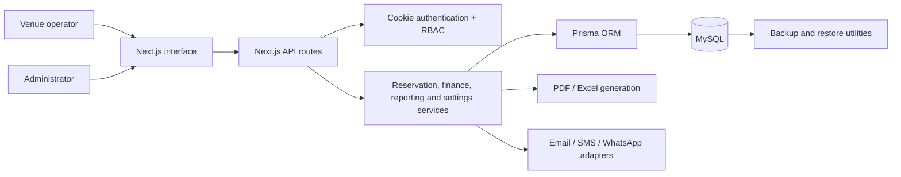

# Eventra — Event & Venue Management System

> A privacy-conscious case study of a production internal platform. Source code,
> credentials, customer records, and operational screenshots are intentionally
> excluded.

[Türkçe sürüm](README.tr.md) · [Architecture](docs/ARCHITECTURE.md) · [Feature map](docs/FEATURE-MAP.md)

## Overview

Eventra is a full-stack B2B system built for the daily operations of an event
and wedding venue. It brings reservations, customers, payments, cash tracking,
reports, communication settings, document templates, and operational
configuration into one internal platform.

| Area | Detail |
|---|---|
| Status | In active internal use |
| Role | End-to-end product and development ownership |
| Product type | Responsive internal web application |
| Scale | Approximately 65 API endpoints and 40 data models |
| Public scope | Case study only; production source remains private |

## The Operational Need

The stakeholder needed one consistent interface for planning events and
controlling the operational information around each reservation. The product
had to support different event types, venues, packages, payment states,
documents, roles, and business settings without turning every change into a
code revision.

## My Role

I owned the project from requirements to operation:

- translated stakeholder requests into product flows and data models;
- shaped the full-stack architecture and modular boundaries;
- implemented, reviewed, tested, and revised features iteratively;
- prepared and maintained the Linux deployment environment;
- used real operational feedback to improve the product after release.

## Core Capabilities

- Multi-range reservation calendar with conflict checks
- Reservation creation, editing, details, and cancellation
- Active and prospective customer management
- Payment records, cash boxes, transaction history, and reservation finance
- Revenue, reservation, and customer reports
- Role-based access control for users, roles, and permissions
- PDF contract and receipt templates
- Excel exports and operational reports
- Email, SMS, WhatsApp, and prepared-message settings
- Venue, office, package, product, pricing, tax, theme, and calendar settings
- Database backup and restore utilities

## Key Engineering Challenge

### A settings-driven reservation form

The most demanding part of the project was preventing the reservation form
from becoming a fixed, tightly coupled screen.

Field definitions, visibility rules, required states, and selectable values are
driven by administrative settings. When an operator opens the form, the
interface is assembled from the current configuration. Submitted values are
stored separately from the field definitions, allowing the business to evolve
the form without redesigning the reservation model for every change.

This required balancing:

- configuration flexibility;
- validation and data integrity;
- predictable editing of existing reservations;
- backward compatibility when settings change;
- a simple workflow for non-technical operators.

## Architecture

See [Architecture](docs/ARCHITECTURE.md) for the component and data-domain
breakdown.

## Technology Stack

| Layer | Technologies |
|---|---|
| Frontend | Next.js 14, React 18, TypeScript, Tailwind CSS, Recharts, dnd-kit |
| Backend | Next.js API Routes, cookie-based authentication, role/permission controls |
| Data | Prisma 6, MySQL, migration and backup scripts |
| Documents | jsPDF, pdf-lib, XLSX |
| Communication | Nodemailer and configurable SMS/WhatsApp modules |
| Infrastructure | Linux server, Nginx, PM2 |

## Scope Boundaries

- Payments are recorded and reported, but the system does not process online card payments.
- The platform is an internal operational product, not a public SaaS signup flow.
- Production URLs, source code, credentials, and customer data are not included in this repository.

## Outcome

Eventra moved from a requested operational tool to a system used in real daily
work. The project gave me practical experience in requirement discovery,
modular product design, database modeling, deployment, maintenance, and
iteration based on user feedback.

## Repository Purpose

This repository documents the engineering work without exposing proprietary
source code or client information. It contains no production secrets and is
not intended to be deployed.
