

# Eventra

**Reservation, finance and operations platform for a wedding & event venue**

Black Wool Project · **Project Lead & Developer** · [Türkçe](README.tr.md)

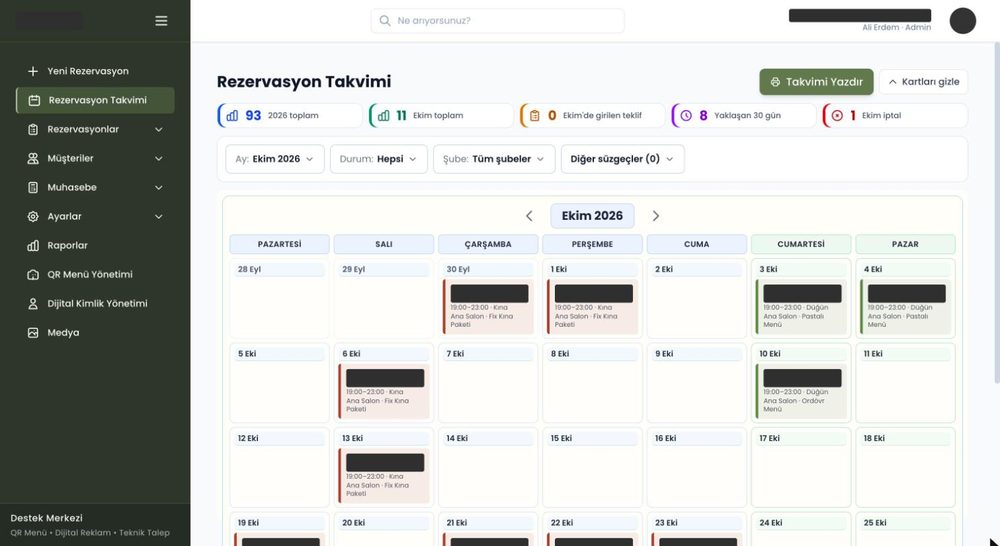

> **About this repository.** Eventra is a commercial product; its source code is private. This is a
> case study. Every screenshot was taken from the **live system** on 28 Oct 2026 and personal and
> financial data was covered with solid boxes before capture. The venue is not named. Menu items for
> features that are not yet built are hidden from the screenshots and are not described below.

---

## At a glance

| | |
|---|---|
| **Client** | A wedding and event venue in Istanbul, two branches |
| **In use since** | September 2026 — the venue runs its daily bookings, payments and contracts on it |
| **Live data** | 99 reservations · 104 customer records · 8 staff accounts · 2 branches |
| **Codebase** | 56 relational models · 109 API route files · 72 screens · 2,275 commits |
| **Access model** | 104 permissions across 36 sections, database-defined roles, field-level visibility |
| **Reports** | 13 reports, 12 of them with period-over-period comparison |
| **My role** | Requirements → data model → implementation → deployment → support after release |

| **Quality checks** | 189 self-written check scripts (`sinav-*`) plus Playwright for browser flows |

Codebase and catalogue figures measured from the repository on 28 Oct 2026. Live-data figures read from the production system's own API on the same day.

---

## The problem

Before Eventra, the venue ran on a calendar, notebooks and spreadsheets. Each event type — wedding,
henna night, engagement, circumcision feast, graduation, meeting — needs different information
(two families' details, guest count, menu, package, extras), and the same evening slot in the same
hall must never be sold twice. Money arrives in pieces: a deposit at booking, instalments, the
balance before the event, sometimes a refund. Staff with different jobs need to see different
things: a sales person should see the booking but not the contract holder's ID number or the
payment history.

The venue needed **one system that the staff can change themselves** — new fields, packages, prices,
templates — without asking a developer every time.

## What I built

| Area | What it does |
|---|---|
| **Reservations & calendar** | Month and year calendar across branches and halls, filters by status/branch, printable calendar, quote → confirmed → cancelled lifecycle |
| **Settings-driven booking form** | Field groups and fields per event type, each switchable *on / required* from the admin screen with a live preview |
| **Customers** | Active and prospective customers, duplicate merge, where-did-they-hear-about-us source tracking |
| **Finance** | Deposits, payments, corrections and refunds as separate permissions; cash boxes (cash, bank, POS); per-reservation finance; account tracking |
| **Documents** | Contract and receipt templates, PDF generated on the server, versioned contract archive |
| **Reports** | 13 reports (reservation list, status, monthly distribution, revenue, income–expense, sales by staff, customer origin…), Excel/CSV export |
| **Roles & permissions** | Roles defined in the database, 104 permissions, field-level rules for sensitive data, “view as this role” preview |
| **Notifications** | Automatic e-mail on confirmation, payment (receipt attached) and cancellation — each switchable per event, off by default; manual "send to customer" with the stored document |
| **QR menu** | Guest-facing menu site (packages, offers, reviews, contact, gallery) edited from the panel in 9 sections with a live preview; packages come from the same records the booking form uses |
| **Digital business card** | Phone-first card page with call / WhatsApp / directions, social links, services, "add to contacts" (vCard download), QR code and solution partners — edited the same way |

---

## Screens

<table>
<tr>
<td width="50%">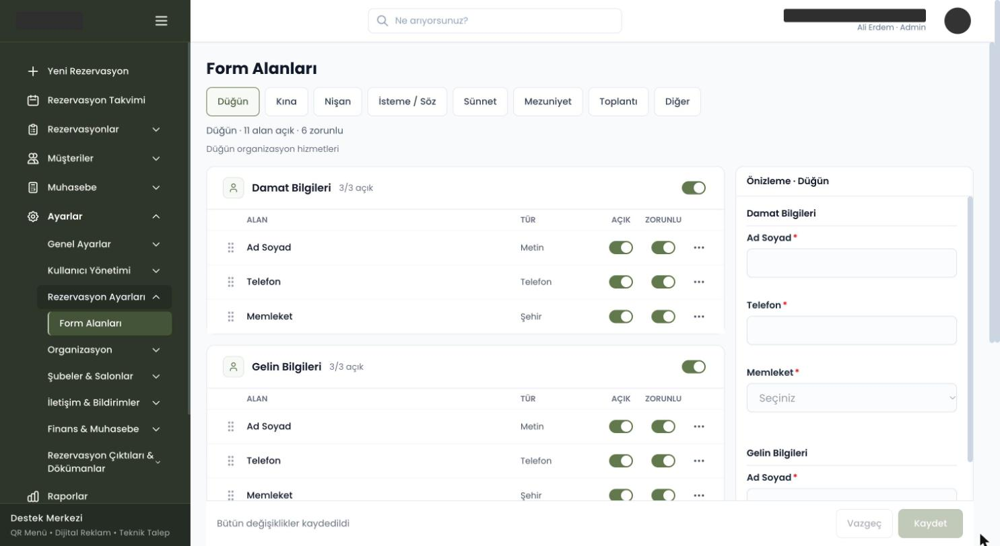 <b>Settings-driven form.</b> Each event type has its own field groups; every field can be switched on or made required. The right pane previews the form staff will see.</td>
<td width="50%">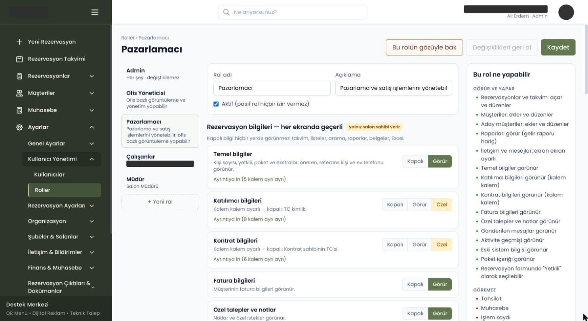 <b>Role editor.</b> Data is grouped by sensitivity (basic, participant, contract, invoice…). A group can be <i>off</i>, <i>visible</i> or <i>custom</i> per field. The right pane summarises what the role can and cannot do.</td>
</tr>
<tr>
<td>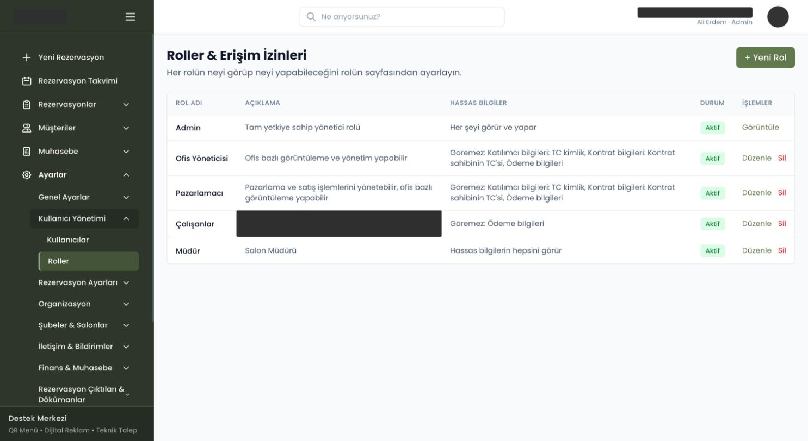 <b>Roles.</b> Every role states which sensitive fields it cannot see — e.g. ID numbers and payment details.</td>
<td>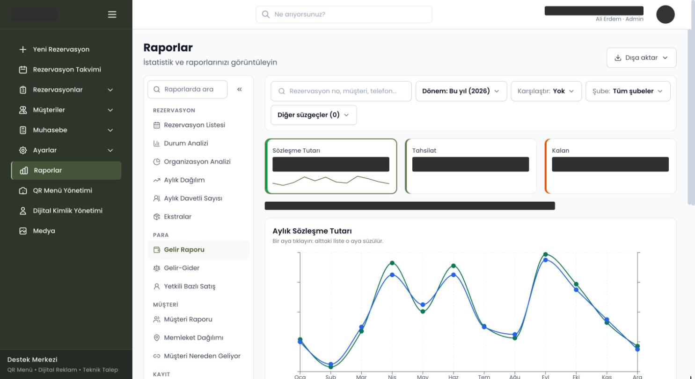 <b>Revenue report.</b> Contract value vs. collected, by month; clicking a month filters the list below. Amounts masked.</td>
</tr>
<tr>
<td>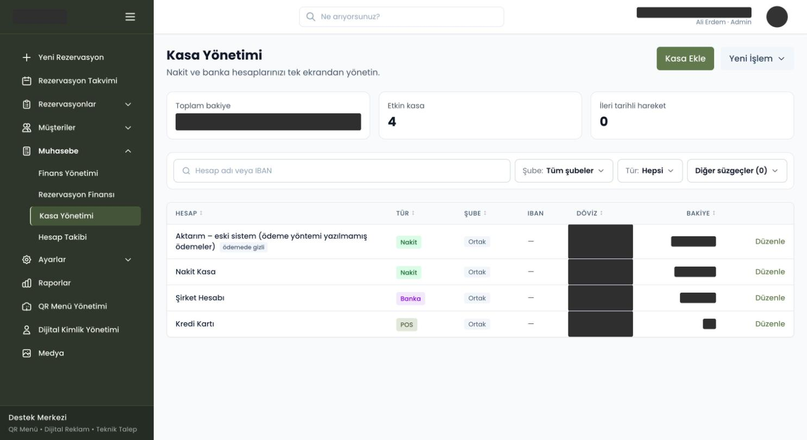 <b>Cash boxes.</b> Cash, bank and POS accounts per branch; balances masked.</td>
<td> <b>Calendar.</b> Colour by event type, time slot, hall and package on each card; customer names masked.</td>
</tr>
</table>

### Guest-facing pages

The venue also publishes two public pages from the same panel: a **QR menu** that guests open from
a table card, and a **digital business card** that staff share by link or QR code. Both are edited
section by section with a live preview, and the menu's packages are read from the same package
records the booking form uses — a price changed once shows up in both places.

<table>
<tr>
<td width="50%">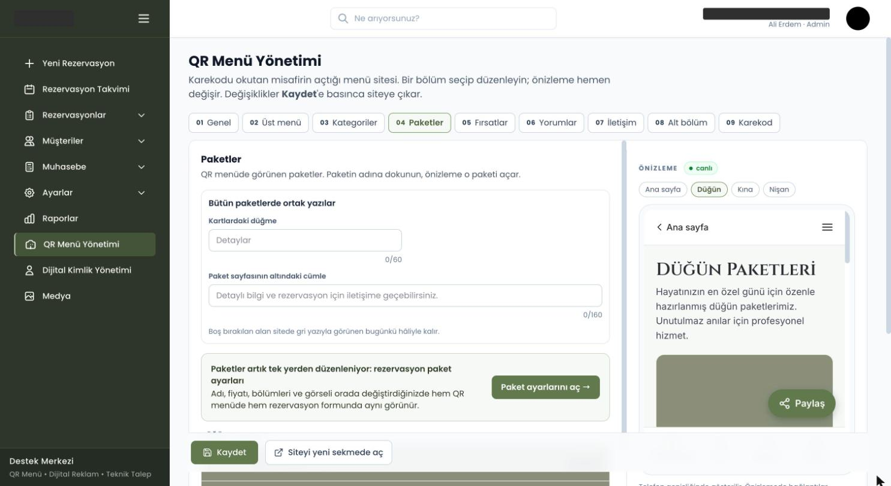 <b>QR menu editor.</b> Nine sections (general, top menu, categories, packages, offers, reviews, contact, footer, QR code); the preview on the right is the live site.</td>
<td width="50%">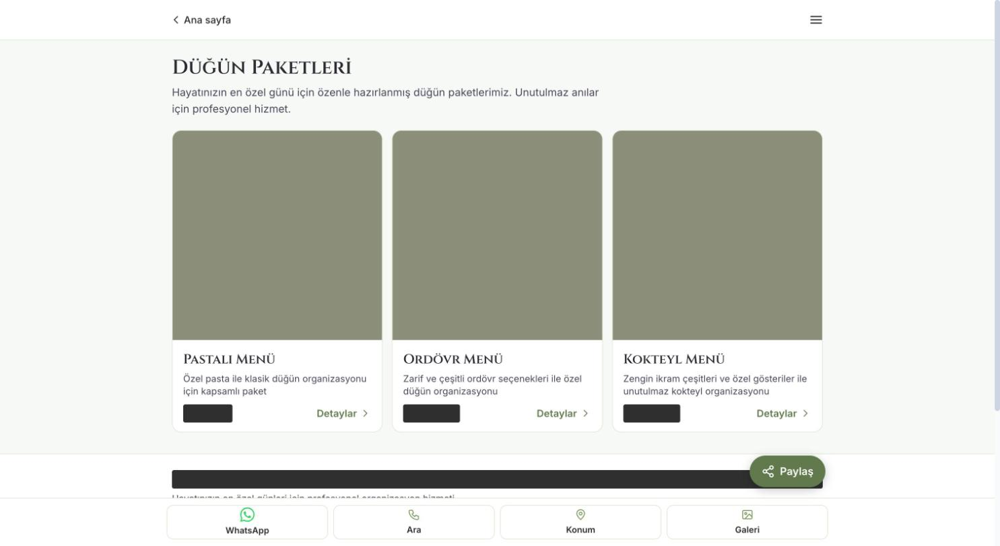 <b>QR menu, guest view.</b> Package cards with details; fixed bar for WhatsApp, call, location and gallery.</td>
</tr>
<tr>
<td>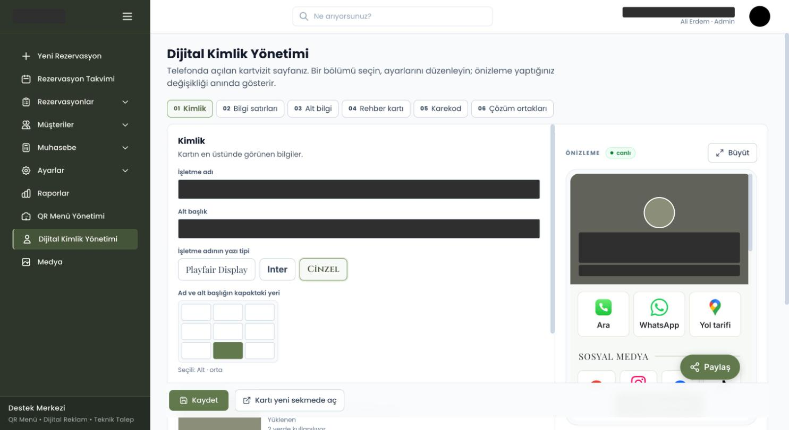 <b>Digital card editor.</b> Name, subtitle, typeface and title position on the cover; info rows, footer, contact card, QR code and partners in separate tabs.</td>
<td>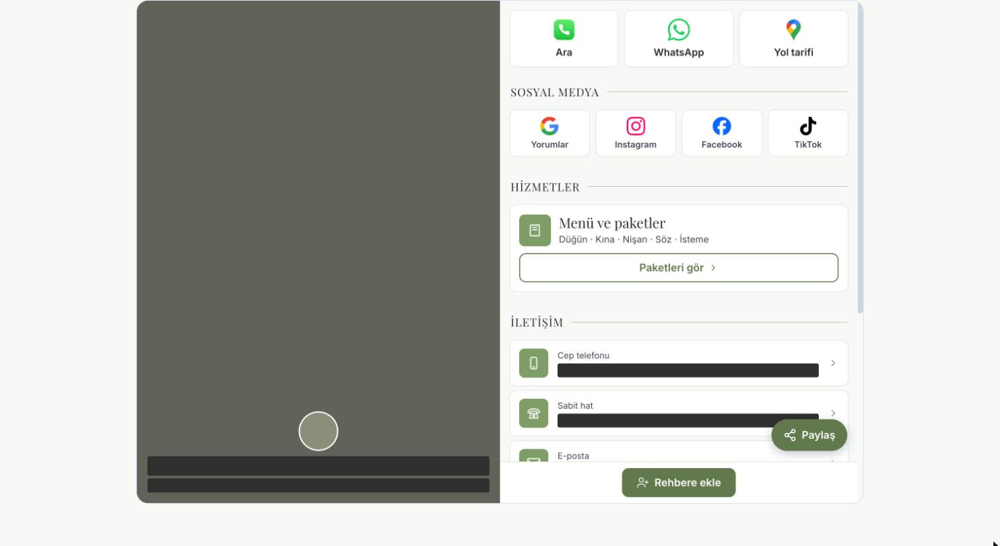 <b>Digital card, public view.</b> One-tap actions, social links, services, contact rows and "add to contacts" (vCard).</td>
</tr>
</table>

On the guest-facing pages the venue's photos, name, slogan, phone numbers and prices are covered.

---

## Architecture

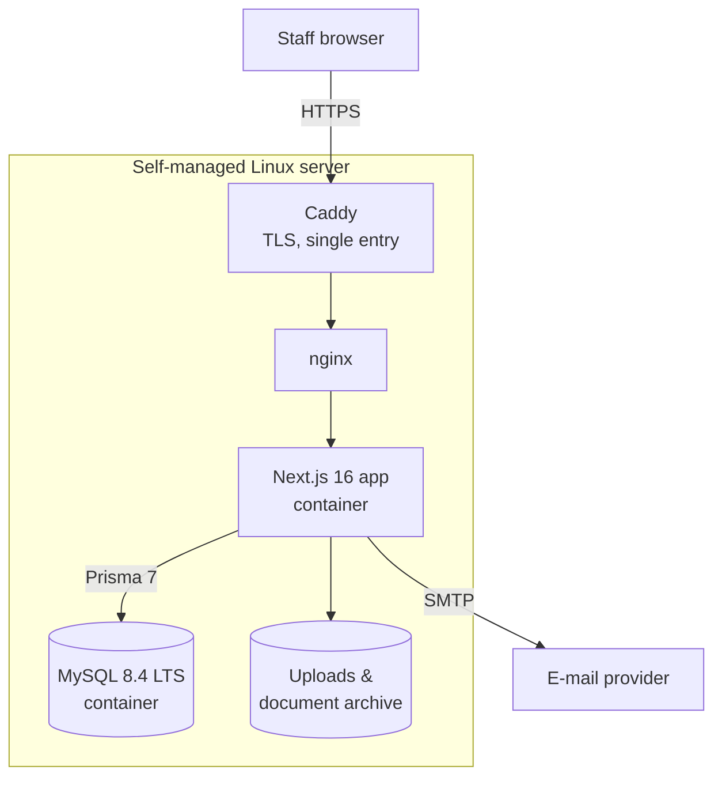

One Next.js application serves both the UI and the API. Every API call goes through the same
gate before any business logic runs:

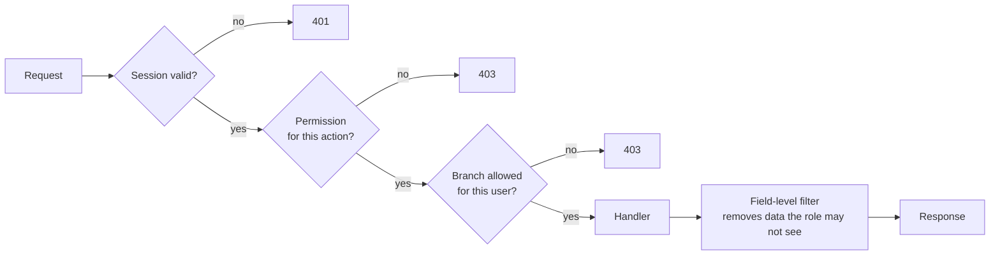

The field-level filter runs **on the server**: a field the role may not see is never sent, so it
cannot leak through the calendar, search, a report or an Excel export.

---

## Engineering decisions

### 1. Double booking is prevented inside the database transaction

Two staff members can try to book the same hall for the same evening at the same moment. Checking
"is the slot free?" and then writing leaves a gap between the two steps.

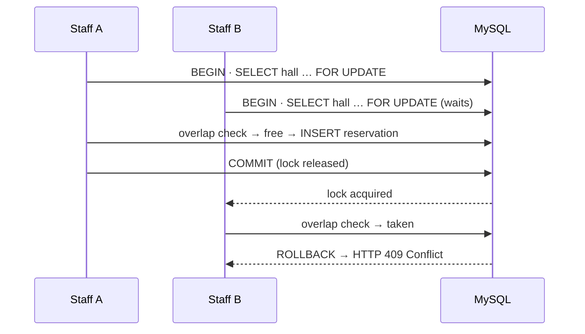

The hall row is locked with `SELECT … FOR UPDATE`, the overlap is re-checked **inside the same
transaction**, and the losing request gets `409 Conflict` with a clear message instead of a silent
duplicate. The same locking pattern protects contract version numbers and cash-box balances.

### 2. Permissions are a catalogue, not scattered `if`s

All 104 permissions live in one typed catalogue (36 sections, ordered like the menu). The database
tables are **generated from that file by a migration script**, so the code and the database cannot
drift apart. Money actions are split on purpose — *take deposit*, *take payment*, *correct/cancel*,
*refund* — because the venue wanted cashiers who can take money but not reverse it.

### 3. The booking form is data

Field definitions, visibility, required flags and option lists are stored as configuration;
submitted values are stored separately from the definitions. Adding "guest's hometown" for weddings
is a settings change, not a schema migration or a deployment.

### 4. Sessions without an auth library

A random token in an `HttpOnly` cookie; the database stores only its **SHA-256 digest**, so a leaked
database does not leak live sessions. Sessions expire after 7 days, are revoked on password change,
and login attempts are rate-limited per e-mail and per address.

### 5. Automatic e-mails never block or break a booking

Confirmation, receipt and cancellation e-mails are sent **after the database transaction has
committed** (Next.js `after`), so staff never wait on the mail server and a mail failure cannot
roll back a reservation or payment. A failed send is written onto the reservation as "could not be
sent — customer has no e-mail" (or the error), visible on its card. Each message is sent at most
once per event, a deposit correction is not treated as a new payment, and every automatic message
starts **off** until the venue switches it on.

### 6. Reproducible releases

Every push builds a Docker image in GitHub Actions and publishes it to GHCR, tagged with the commit
that produced it. The database image is pinned by digest (`mysql:8.4.x@sha256:…`), not `latest`.
A separate staging environment receives every release before production.

---

## Tech stack

| Layer | Technology |
|---|---|
| Frontend | Next.js 16 (App Router), React 19, TypeScript, Tailwind CSS 4, TanStack Table, Recharts, dnd-kit |
| Backend | Next.js route handlers, Prisma ORM 7, MySQL 8.4 LTS |
| Documents | jsPDF, pdf-lib, SheetJS (Excel/CSV), QR codes |
| Delivery | Docker, GitHub Actions → GHCR, Caddy, nginx, self-managed Linux |

---

## My role

I led the project for Black Wool from the first requirement meeting to support after go-live:
turning the venue's requests into written tasks with acceptance criteria, designing the data model
and the permission system, implementing features across UI and API, building the release pipeline
and the staging/production environments, and handling feedback from daily use. Technical review and
feedback came from a senior colleague at Black Wool.

## What is not in this repository

Source code, credentials, production URLs, customer records, prices and the venue's name.
Screens for features that are still placeholders (e.g. an AI chat module) are excluded.
