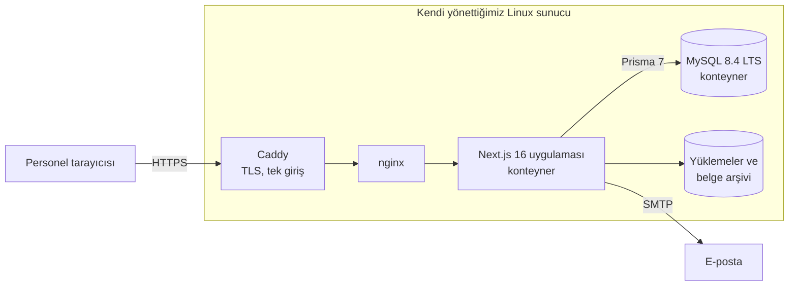
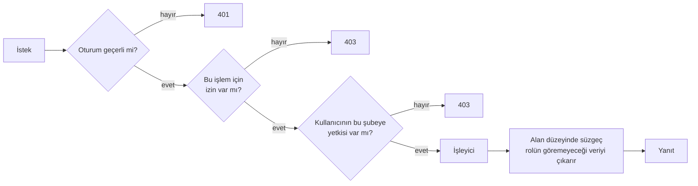
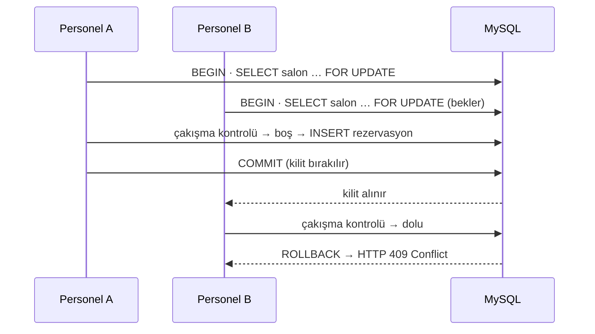

# Eventra

**Düğün ve davet salonu için rezervasyon, finans ve operasyon platformu**

Black Wool Project · **Project Lead & Developer** · [English](README.md)

> **Bu depo hakkında.** Eventra ticari bir ürün; kaynak kodu gizli. Bu bir vaka çalışmasıdır. Bütün
> ekran görüntüleri 28 Ekim 2026'da **canlı sistemden** çekildi; kişisel ve finansal veriler çekimden
> önce düz kutuyla kapatıldı. Salonun adı verilmiyor. Henüz yapılmamış özelliklerin menüleri
> görüntülerden çıkarıldı ve aşağıda anlatılmıyor.

---

## Özet

| | |
|---|---|
| **Müşteri** | İstanbul'da iki şubeli bir düğün ve davet salonu |
| **Kullanımda** | Eylül 2026'dan beri — salon günlük rezervasyonlarını, tahsilatını ve sözleşmelerini bununla yürütüyor |
| **Canlı veri** | 99 rezervasyon · 104 müşteri kaydı · 8 personel hesabı · 2 şube |
| **Kod tabanı** | 56 ilişkisel model · 109 API route dosyası · 72 ekran · 2.275 commit |
| **Erişim modeli** | 36 bölümde 104 izin, veritabanında tanımlı roller, alan düzeyinde görünürlük |
| **Raporlar** | 13 rapor, 12'si dönem karşılaştırmalı |
| **Rolüm** | Gereksinim → veri modeli → geliştirme → canlıya alma → canlı sonrası destek |
| **Kalite kontrolü** | Kendi yazdığım 189 kontrol betiği (`sinav-*`) ve tarayıcı akışları için Playwright |

Kod ve katalog sayıları 28 Ekim 2026'da depodan ölçüldü. Canlı veri sayıları aynı gün canlı sistemin kendi API'sinden okundu.

---

## Sorun

Eventra'dan önce salon bir takvim, defterler ve tablolarla yürüyordu. Her organizasyon türü —
düğün, kına, nişan, sünnet, mezuniyet, toplantı — farklı bilgi ister (iki ailenin bilgileri, kişi
sayısı, menü, paket, ekstralar) ve aynı salonun aynı akşamı asla iki kez satılmamalıdır. Para
parça parça gelir: rezervasyonda kapora, taksitler, organizasyondan önce kalan, bazen iade.
Farklı işi yapan personelin farklı şeyleri görmesi gerekir: satışçı rezervasyonu görmeli ama
sözleşme sahibinin kimlik numarasını ya da ödeme geçmişini görmemelidir.

Salonun ihtiyacı, **personelin kendisinin değiştirebildiği tek bir sistemdi** — yeni alan, paket,
fiyat, şablon — her seferinde bir yazılımcıya sormadan.

## Ne yaptım

| Alan | Ne yapar |
|---|---|
| **Rezervasyon ve takvim** | Şube ve salonlar arasında aylık ve yıllık takvim, durum/şube süzgeçleri, yazdırılabilir takvim, teklif → kesin → iptal yaşam döngüsü |
| **Ayarlardan kurulan rezervasyon formu** | Her organizasyon türü için alan grupları ve alanlar; her alan yönetim ekranından *açık / zorunlu* yapılır, canlı önizlemeyle |
| **Müşteriler** | Aktif ve aday müşteriler, mükerrer kayıt birleştirme, "bizi nereden duydu" kaynak takibi |
| **Finans** | Kapora, ödeme, düzeltme ve iade ayrı izinler; kasalar (nakit, banka, POS); rezervasyon finansı; hesap takibi |
| **Belgeler** | Sözleşme ve tahsilat fişi şablonları, sunucuda üretilen PDF, sürümlü sözleşme arşivi |
| **Raporlar** | 13 rapor (rezervasyon listesi, durum, aylık dağılım, gelir, gelir–gider, yetkiliye göre satış, müşteri kaynağı…), Excel/CSV dışa aktarma |
| **Roller ve izinler** | Veritabanında tanımlı roller, 104 izin, hassas veri için alan düzeyinde kurallar, "bu rolün gözüyle bak" önizlemesi |
| **Bildirimler** | Kesinleşme, tahsilat (fiş ekli) ve iptalde otomatik e-posta — her biri olay başına açılıp kapanır, varsayılan kapalı; kayıtlı belgeyle elle "müşteriye gönder" |
| **QR menü** | Misafire açık menü sitesi (paketler, fırsatlar, yorumlar, iletişim, galeri); panelden 9 bölümde, canlı önizlemeyle düzenlenir; paketler rezervasyon formunun kullandığı kayıtlardan gelir |
| **Dijital kartvizit** | Telefon öncelikli kart sayfası: ara / WhatsApp / yol tarifi, sosyal bağlantılar, hizmetler, "rehbere ekle" (vCard indirme), karekod ve çözüm ortakları — aynı yöntemle düzenlenir |

---

## Ekranlar

<table>
<tr>
<td width="50%"> <b>Ayarlardan kurulan form.</b> Her organizasyon türünün kendi alan grupları var; her alan açılıp kapanır ya da zorunlu yapılır. Sağdaki bölme personelin göreceği formu önizler.</td>
<td width="50%"> <b>Rol düzenleyici.</b> Veriler hassasiyete göre gruplu (temel, katılımcı, kontrat, fatura…). Bir grup rol başına <i>kapalı</i>, <i>görür</i> ya da alan alan <i>özel</i> olabilir. Sağ bölme rolün neyi yapıp neyi yapamadığını özetler.</td>
</tr>
<tr>
<td> <b>Roller.</b> Her rol göremediği hassas alanları açıkça yazar — ör. kimlik numaraları ve ödeme bilgileri.</td>
<td> <b>Gelir raporu.</b> Aylara göre sözleşme tutarı ve tahsilat; bir aya tıklamak alttaki listeyi süzer. Tutarlar kapalı.</td>
</tr>
<tr>
<td> <b>Kasalar.</b> Şube başına nakit, banka ve POS hesapları; bakiyeler kapalı.</td>
<td> <b>Takvim.</b> Organizasyon türüne göre renk; her kartta saat dilimi, salon ve paket. Müşteri adları kapalı.</td>
</tr>
</table>

### Misafire açık sayfalar

Salon aynı panelden iki herkese açık sayfa daha yayımlıyor: misafirlerin masadaki karttan açtığı
bir **QR menü** ve personelin bağlantı ya da karekodla paylaştığı bir **dijital kartvizit**. İkisi de
bölüm bölüm, canlı önizlemeyle düzenleniyor. Menüdeki paketler rezervasyon formunun kullandığı paket
kayıtlarından okunuyor — bir kez değiştirilen fiyat iki yerde birden görünüyor.

<table>
<tr>
<td width="50%"> <b>QR menü düzenleyici.</b> Dokuz bölüm (genel, üst menü, kategoriler, paketler, fırsatlar, yorumlar, iletişim, alt bölüm, karekod); sağdaki önizleme canlı sitedir.</td>
<td width="50%"> <b>QR menü, misafir görünümü.</b> Ayrıntılı paket kartları; WhatsApp, arama, konum ve galeri için sabit çubuk.</td>
</tr>
<tr>
<td> <b>Kartvizit düzenleyici.</b> Kapakta ad, alt başlık, yazı tipi ve başlık konumu; bilgi satırları, alt bilgi, rehber kartı, karekod ve çözüm ortakları ayrı sekmelerde.</td>
<td> <b>Dijital kartvizit, herkese açık görünüm.</b> Tek dokunuşla eylemler, sosyal bağlantılar, hizmetler, iletişim satırları ve "rehbere ekle" (vCard).</td>
</tr>
</table>

Misafire açık sayfalarda salonun fotoğrafları, adı, sloganı, telefonları ve fiyatları kapatıldı.

---

## Mimari

Tek bir Next.js uygulaması hem arayüzü hem API'yi sunuyor. Her API çağrısı, iş mantığı çalışmadan
önce aynı kapıdan geçiyor:

Alan düzeyindeki süzgeç **sunucuda** çalışıyor: rolün göremeyeceği bir alan hiç gönderilmiyor;
böylece takvimden, aramadan, bir rapordan ya da Excel çıktısından sızamıyor.

---

## Mühendislik kararları

### 1. Çifte rezervasyon veritabanı işleminin içinde önleniyor

İki personel aynı salonu aynı akşam için aynı anda ayırmaya çalışabilir. Önce "boş mu?" diye bakıp
sonra yazmak, iki adım arasında bir boşluk bırakır.

Salon satırı `SELECT … FOR UPDATE` ile kilitleniyor, çakışma **aynı işlemin içinde** yeniden
kontrol ediliyor ve kaybeden istek sessiz bir mükerrer kayıt yerine açık bir mesajla
`409 Conflict` alıyor. Aynı kilit düzeni sözleşme sürüm numaralarını ve kasa bakiyelerini de koruyor.

### 2. İzinler dağınık `if`'ler değil, bir katalog

104 iznin hepsi tek, tipli bir katalogda duruyor (36 bölüm, menü sırasıyla). Veritabanı tabloları
**bu dosyadan bir göç betiğiyle üretiliyor**; böylece kod ile veritabanı birbirinden ayrışamıyor.
Para işlemleri bilerek ayrıldı — *kapora al*, *ödeme al*, *düzelt/iptal et*, *iade* — çünkü salon,
para alabilen ama geri alamayan kasiyerler istedi.

### 3. Rezervasyon formu veridir

Alan tanımları, görünürlük, zorunluluk ve seçenek listeleri ayar olarak saklanıyor; girilen
değerler tanımlardan ayrı tutuluyor. Düğünlere "misafirin memleketi" alanını eklemek bir ayar
değişikliği; şema göçü ya da yeni sürüm gerektirmiyor.

### 4. Kimlik doğrulama kütüphanesi olmadan oturum

`HttpOnly` bir çerezde rastgele bir belirteç; veritabanı yalnız onun **SHA-256 özetini** saklıyor,
böylece sızan bir veritabanı canlı oturumları sızdırmıyor. Oturumlar 7 gün sonra bitiyor, parola
değişince iptal ediliyor ve giriş denemeleri e-posta ve adres başına sınırlanıyor.

### 5. Otomatik e-postalar bir rezervasyonu ne bekletir ne bozar

Onay, fiş ve iptal e-postaları **veritabanı işlemi tamamlandıktan sonra** gönderiliyor (Next.js
`after`); personel posta sunucusunu beklemiyor ve bir gönderim hatası rezervasyonu ya da ödemeyi
geri alamıyor. Başarısız gönderim rezervasyonun kartına "gönderilemedi — müşterinin e-postası yok"
(ya da hata) olarak yazılıyor. Her mesaj olay başına en fazla bir kez gidiyor, kapora düzeltmesi
yeni bir ödeme sayılmıyor ve her otomatik mesaj salon açana kadar **kapalı** başlıyor.

### 6. Tekrarlanabilir sürümler

Her push GitHub Actions'ta bir Docker imajı derliyor ve onu üreten commit'le etiketleyip GHCR'a
gönderiyor. Veritabanı imajı `latest` ile değil, parmak iziyle sabitleniyor (`mysql:8.4.x@sha256:…`).
Her sürüm canlıdan önce ayrı bir deneme ortamına çıkıyor.

---

## Teknolojiler

| Katman | Teknoloji |
|---|---|
| Ön yüz | Next.js 16 (App Router), React 19, TypeScript, Tailwind CSS 4, TanStack Table, Recharts, dnd-kit |
| Arka uç | Next.js route handler'ları, Prisma ORM 7, MySQL 8.4 LTS |
| Belgeler | jsPDF, pdf-lib, SheetJS (Excel/CSV), karekod |
| Dağıtım | Docker, GitHub Actions → GHCR, Caddy, nginx, kendi yönettiğimiz Linux sunucu |

---

## Rolüm

Projeyi Black Wool adına ilk gereksinim toplantısından canlı sonrası desteğe kadar yönettim:
salonun isteklerini kabul ölçütleri yazılı işlere çevirdim, veri modelini ve izin sistemini
tasarladım, özellikleri arayüz ve API boyunca geliştirdim, sürüm hattını ve deneme/canlı ortamlarını
kurdum, günlük kullanımdan gelen geri bildirimleri işledim. Teknik inceleme ve geri bildirim Black
Wool'daki kıdemli bir çalışma arkadaşımdan geldi.

## Bu depoda olmayanlar

Kaynak kod, erişim bilgileri, canlı adresler, müşteri kayıtları, fiyatlar ve salonun adı.
Henüz yer tutucu olan özelliklerin ekranları (ör. bir yapay zekâ sohbet modülü) dahil edilmedi.
