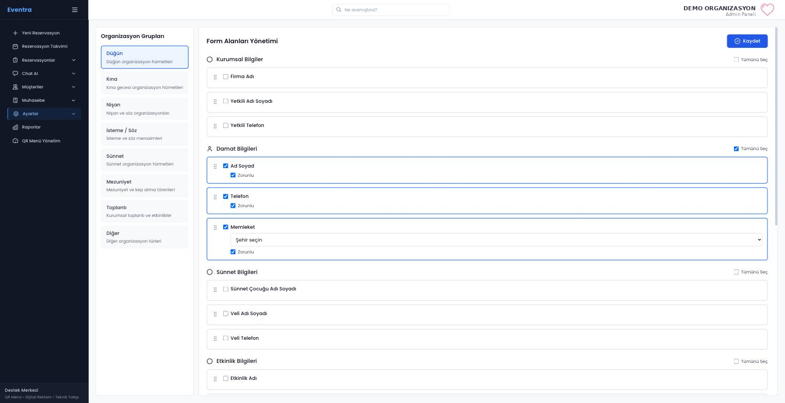
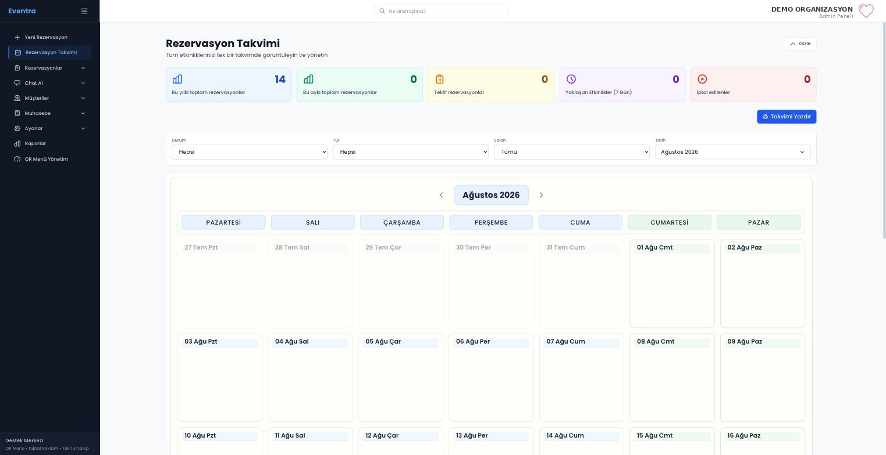
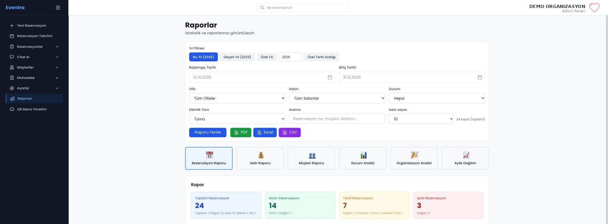

# Eventra — Etkinlik ve Mekân Yönetim Sistemi

> Bu depo, bir müşteriye teslim edilen B2B iç sistemin gizlilik odaklı vaka çalışmasıdır.
> Kaynak kodu, erişim bilgileri ve müşteri kayıtları bilerek paylaşılmamıştır.
> Aşağıdaki ekran görüntüleri yalnızca yapılandırma ve toplu görünümleri
> içerir — rezervasyon kaydı ve müşteri verisi yoktur, işletme adı maskelenmiştir.

[English version](README.md) · [Mimari](docs/ARCHITECTURE.md) · [Özellik haritası](docs/FEATURE-MAP.md)

## Genel Bakış

Eventra; bir etkinlik ve düğün salonunun rezervasyon, müşteri, ödeme, kasa,
raporlama, iletişim, belge şablonu ve operasyon ayarlarını tek iç sistemde
toplayan full-stack bir B2B uygulamasıdır.

| Alan | Bilgi |
|---|---|
| Durum | Müşteriye teslim edildi; kabul bekleniyor |
| Rolüm | Ürün ve geliştirme sürecinin uçtan uca sahipliği |
| Ürün türü | Mobil ve masaüstü uyumlu iç web uygulaması |
| Ölçek | Yaklaşık 65 API uç noktası ve 40 veri modeli |
| Açık kapsam | Yalnızca vaka çalışması; üretim kodu özel depoda |

## İhtiyaç

Paydaşın etkinlik planlamasını ve her rezervasyonun çevresindeki operasyonel
bilgileri tek bir tutarlı arayüzden yönetmesi gerekiyordu. Sistem; farklı
etkinlik türleri, salonlar, paketler, ödeme durumları, belgeler, roller ve
işletme ayarlarını desteklemeli, her değişiklikte kod revizyonu
gerektirmemeliydi.

## Rolüm

- İstekleri ürün akışlarına ve veri modellerine dönüştürdüm.
- Full-stack mimariyi ve modüler sınırları şekillendirdim.
- Özellikleri geliştirip kontrol ederek geri bildirimlerle revize ettim.
- Linux sunucu, Nginx ve PM2 ortamını hazırlayıp bakımını yaptım.
- Teslim öncesi test, hata ayıklama ve devir süreçlerini yürüttüm.

## Temel Özellikler

- Çakışma kontrollü çok aralıklı rezervasyon takvimi
- Rezervasyon oluşturma, düzenleme, detay ve iptal akışları
- Aktif ve aday müşteri yönetimi
- Ödeme kayıtları, kasalar, hareket geçmişi ve rezervasyon finansı
- Gelir, rezervasyon ve müşteri raporları
- Kullanıcı, rol ve izin yönetimi
- PDF sözleşme ve tahsilat fişi şablonları
- Excel dışa aktarımları
- E-posta, SMS, WhatsApp ve hazır mesaj ayarları
- Salon, ofis, paket, ürün, fiyat, KDV, tema ve takvim ayarları
- Veritabanı yedekleme ve geri yükleme araçları

## En Zor Mühendislik Problemi

Rezervasyon formunun sabit ve birbirine sıkı bağlı alanlardan oluşmasını
engellemek projenin en zahmetli kısmıydı.

Alan tanımları, görünürlük kuralları, zorunluluk durumları ve seçenekler yönetim
ayarlarından geliyor. Operatör formu açtığında arayüz güncel yapılandırmaya göre
oluşturuluyor. Girilen değerler alan tanımlarından ayrı saklandığı için işletme,
her değişiklikte rezervasyon modelini yeniden tasarlamadan formu
özelleştirebiliyor.

Bu tasarımda esneklik, doğrulama, eski rezervasyonların düzenlenebilmesi ve
teknik olmayan kullanıcıların kolaylığı birlikte dengelendi.

## Teknolojiler

Next.js 14, React 18, TypeScript, Tailwind CSS, Recharts, dnd-kit, Next.js API
Routes, Prisma 6, MySQL, jsPDF, pdf-lib, XLSX, Nodemailer, Linux, Nginx ve PM2.

## Arayüz

### Ayarlardan yönetilen rezervasyon formu

Yukarıda anlatılan mühendislik probleminin arkasındaki ekran budur. Soldaki her
organizasyon türü — düğün, kına, nişan, sünnet, mezuniyet, kurumsal toplantı —
kendi alan yapılandırmasını taşır: hangi alanlar var, hangileri zorunlu, hangi
sırayla görünüyor, hangi seçenek listesinden besleniyor.

Bir etkinlik türüne alan eklemek, zorunlu işaretlemek, sırasını değiştirmek veya
seçenek listesi bağlamak bir yönetici işlemidir. Hiçbiri şema göçü veya kod
değişikliği gerektirmez; modülerlik gereksiniminin istediği tam olarak budur.

### Rezervasyon takvimi

Durum, etkinlik türü, salon ve tarih filtreleriyle ay görünümü; üstte özet
sayaçlar. Rezervasyon bulunmayan bir ayda gösterilmiştir.

### Raporlama

Ortak filtre seti üzerinde altı rapor türü — rezervasyon, gelir, müşteri, durum
analizi, organizasyon analizi ve aylık dağılım — PDF, Excel ve CSV dışa
aktarımıyla. Bu özetlerin altındaki kayıt tablosu bilinçli olarak kadraj dışında
bırakılmıştır.

## Sonuç

Eventra, işletmenin aşmış olduğu defter ve basit program karışımı bir sürecin
yerini almak üzere tasarlandı. Sistem teslim edildi ve müşteri kabulü
bekleniyor. Proje bana gereksinim çıkarma, modüler tasarım, veritabanı
modelleme, canlıya alma ve devir deneyimi kazandırdı.

Bu depo dağıtılabilir ürün kodu değil, yapılan mühendislik çalışmasının güvenli
ve doğrulanabilir sunumudur.
