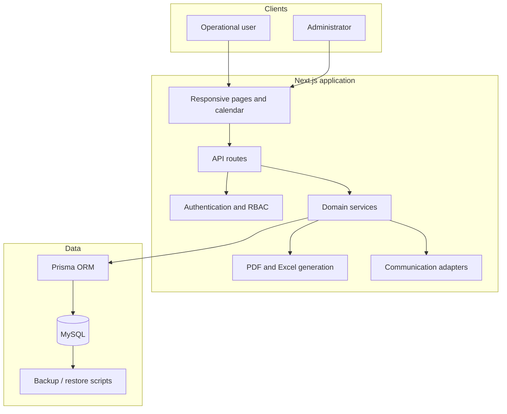
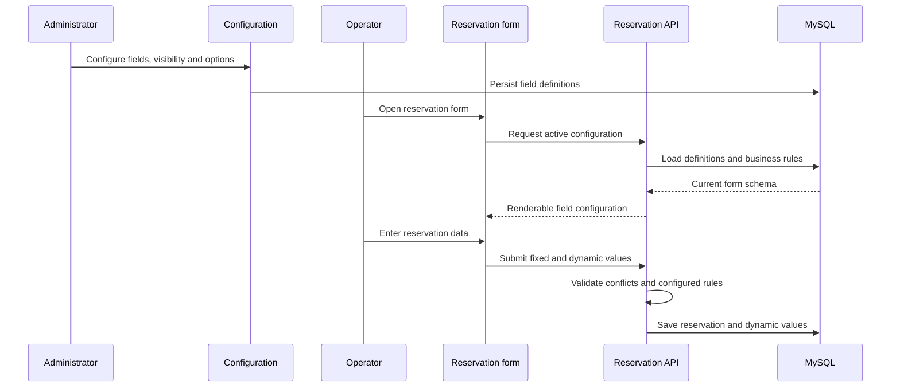

# Eventra Architecture

## Component View

## Main Data Domains

| Domain | Representative responsibilities |
|---|---|
| Reservations | Events, participants, dynamic values, conflict checks |
| Customers | Active and prospective customer records |
| Finance | Payments, cash boxes, transactions, pricing, tax |
| Organization | Offices, branches, venues, packages, products |
| Access | Users, roles, permissions |
| Documents | Contract and receipt templates |
| Configuration | Form fields, visibility, calendar, theme, communication |
| Reporting | Revenue, reservation, customer, and date-based summaries |

## Dynamic Reservation Form Flow

## Design Decisions

### Configuration separated from submitted values

Field definitions and reservation values are modeled separately. This keeps
historical records usable while allowing the active form configuration to
change.

### Business modules share one operational database

Reservations, finance, reporting, and customer operations use the same source
of truth. Cross-module actions are validated in the backend rather than being
coordinated only in the interface.

### Internal-first security model

The application is designed as a protected internal panel with authenticated
access and role-based permissions. Public indexing is intentionally disabled.

### Payment tracking is not payment processing

The finance module records and reports operational collections. It does not
represent an online card-processing or virtual-POS integration.
